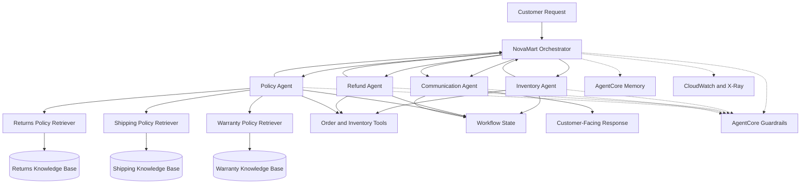

<div align="center">

# 🛒 NovaMart

### Multi-Agent E-Commerce Customer Support System

*An AWS-powered, multi-agent AI customer-support system with specialized agents, policy-grounded retrieval, workflow state management, safety guardrails, conversational memory, and end-to-end observability.*


</div>

---

## 📑 Contents

[Overview](#-overview) · [Objectives](#-objectives) · [Architecture](#-architecture) · [Multi-Agent Design](#-multi-agent-design) · [Knowledge Bases](#-policy-retrieval-and-knowledge-bases) · [Workflow State](#-workflow-state-management) · [Guardrails](#-safety-and-guardrails) · [Memory](#-conversational-memory) · [Deployment](#-deployment-and-infrastructure) · [Observability](#-observability) · [Tech Stack](#-technology-stack) · [Repo Structure](#-repository-structure) · [Setup](#-setup) · [Testing](#-testing) · [Verification](#-deployment-verification) · [Practices](#-engineering-practices) · [Future](#-future-improvements) · [Outcome](#-project-outcome)

---

## 📖 Overview

E-commerce customer support often requires agents to investigate orders, check inventory, interpret return and warranty policies, process refund requests, and communicate clear resolutions to customers. Handling these tasks through a single general-purpose AI model can make workflows difficult to control, validate, and monitor.

**NovaMart addresses this with a multi-agent architecture.** An orchestrator coordinates specialized agents, retrieves relevant policy information from knowledge bases, and delegates customer-facing response generation to a dedicated communication agent.

The project was built as an enterprise AI solutions architecture implementation using **Amazon Bedrock AgentCore** and the **Strands Agents SDK**.

## 🎯 Objectives

- Build a multi-agent system that coordinates specialized customer-support agents.
- Route requests to the appropriate worker based on the customer's intent and workflow context.
- Retrieve relevant information from Returns, Shipping, and Warranty policy knowledge bases.
- Maintain workflow state and apply version-aware state updates.
- Apply guardrails to improve safety and control model responses.
- Maintain session summaries using AgentCore Memory.
- Deploy the agent system to Amazon Bedrock AgentCore Runtime.
- Capture logs and distributed traces using Amazon CloudWatch and AWS X-Ray.
- Validate the implementation with automated tests.

## 🏗 Architecture



*Conceptual architecture of the application. AgentCore Runtime hosts the deployed application; the diagram focuses on the application-level agent workflow and supporting services.*

## 🤖 Multi-Agent Design

| Agent | Role | Key tools |
|---|---|---|
| 🧭 **Orchestrator** | Central coordination: interprets requests, routes tasks to specialists, maintains workflow context, and hands completed workflows to the Communication Agent | Routing, policy retrieval via Policy Agent |
| 📦 **Inventory Agent** | Handles order and inventory-related enquiries | `check_order_status` · `get_customer_tier` · `list_customer_orders` · `get_inventory_context` |
| 💸 **Refund Agent** | Supports refund workflows using refund functionality and customer/order context | `initiate_refund` |
| 📜 **Policy Agent** | Retrieves Returns, Shipping and Warranty policy information using dedicated retrieval tools instead of relying on the model's general knowledge | `retrieve_*_policy` · `search_all_policies` |
| 💬 **Communication Agent** | Produces the final customer-facing response from the results and context assembled by the other agents | n/a |

<details>
<summary><b>Design notes</b></summary>

- The orchestration design **separates task coordination from customer communication**.
- Refund actions should be governed by the application's business rules and validated workflow context rather than being treated as unrestricted language-model decisions.

</details>

## 📚 Policy Retrieval and Knowledge Bases

NovaMart uses three Amazon Bedrock Knowledge Bases backed by Amazon S3 Vectors.

| Knowledge domain | Vector index | Retrieval tool |
|---|---|---|
| Returns | `returns-policy-index` | `retrieve_returns_policy` |
| Shipping | `shipping-policy-index` | `retrieve_shipping_policy` |
| Warranty | `warranty-policy-index` | `retrieve_warranty_policy` |
| All three | n/a | `search_all_policies` |

The combined search (`search_all_policies`) uses **concurrent retrieval**, so the three policy domains are queried in parallel.

### Vector configuration

The deployed indexes were verified with the following configuration:

| Setting | Value |
|---|---|
| Vector storage | Amazon S3 Vectors |
| Data type | `float32` |
| Embedding dimension | `1024` |
| Distance metric | Cosine |
| Embedding model | Amazon Titan Text Embeddings V2 |
| Metadata configuration | `AMAZON_BEDROCK_TEXT` |

All three knowledge bases reported `ACTIVE` status, and their latest ingestion jobs reported `COMPLETE`.

## 🔁 Workflow State Management

The application includes a `WorkflowState` mechanism to maintain context across the support workflow.

- **Version-aware updates** use an expected-version value, which helps detect conflicting updates and supports more controlled state transitions as multiple agents contribute to a workflow.
- The design also includes tools for retrieving workflow context and initializing a session.

## 🛡 Safety and Guardrails

Amazon Bedrock AgentCore Guardrails are integrated into the agent configuration. The configured guardrail is applied to the **orchestrator and all four worker agents** (Inventory, Refund, Policy and Communication).

It is intended to support safer processing of customer-support requests, including the relevant content and privacy controls established in the project configuration. The guardrail configuration and associated automated tests were validated as part of the project.

## 🧠 Conversational Memory

NovaMart integrates Amazon Bedrock AgentCore Memory to support session-level context.

| Setting | Value |
|---|---|
| Strategy | **SessionSummary** |
| Event retention | 7 days |

The configuration summarizes session context so the application can maintain continuity across a customer-support interaction without treating the entire conversation as an unstructured prompt.

## ☁️ Deployment and Infrastructure

The application was deployed to **Amazon Bedrock AgentCore Runtime**, and the deployed runtime was verified in the `READY` state. The project configuration includes the runtime ARN and the environment variables required to connect the application to its supporting AWS resources.

**Supporting AWS services**

- Amazon Bedrock AgentCore Runtime
- Amazon Bedrock AgentCore Guardrails
- Amazon Bedrock AgentCore Memory
- Amazon Bedrock Knowledge Bases
- Amazon S3 Vectors
- Amazon CloudWatch
- AWS X-Ray

The project also includes AgentCore configuration and infrastructure-related files.

## 🔭 Observability

Logging and distributed tracing support debugging and operational visibility.

| Service | What it provides |
|---|---|
| **Amazon CloudWatch** | Application log visibility, including agent execution activity, tool calls, and execution-related information |
| **AWS X-Ray** | Trace visibility for the agent workflow; the service map and trace views help inspect interactions between the orchestrator and downstream components |

The project was tested with logging and tracing enabled, including verification of the configured tracing sampling rate.

> [!NOTE]
> Observability matters in multi-agent systems because a single customer request can involve multiple agents, tool executions, and retrieval operations.

## 🧰 Technology Stack

| Technology | Role |
|---|---|
| Python | Application implementation |
| Strands Agents SDK | Agent construction and orchestration |
| Amazon Bedrock AgentCore Runtime | Application runtime deployment |
| Amazon Bedrock AgentCore Guardrails | Guardrail integration |
| Amazon Bedrock AgentCore Memory | Session-summary memory |
| Amazon Bedrock Knowledge Bases | Policy knowledge retrieval |
| Amazon Titan Text Embeddings V2 | Text embedding generation |
| Amazon S3 Vectors | Vector storage and similarity search |
| Amazon CloudWatch | Logs and operational monitoring |
| AWS X-Ray | Distributed tracing |
| AWS CLI | AWS resource inspection and verification |
| Pytest / project test runner | Automated validation |

## 🗂 Repository Structure

```text
project/
├── src/
│   └── agent_orchestrator.py
├── tests/
│   └── test_agent.py
├── agentcore/
├── infrastructure/
├── diagrams/
├── submission-evidence-20261019/
├── config.py
├── .env.example
├── .gitignore
├── requirements.txt
├── README.md
└── vector-exports.yaml
```

Additional files may be present in the working repository, including deployment outputs and build artifacts.

## ⚙️ Setup

### Prerequisites

- Python installed at a version compatible with the project dependencies
- AWS CLI installed and configured
- Access to the AWS account and region containing the deployed resources
- Appropriate IAM permissions for the required AWS services
- Access to the project's configured AgentCore Runtime, memory, guardrail, and knowledge bases

### 1. Clone the repository

```bash
git clone <your-repository-url>
cd <repository-directory>
```

Replace the placeholders with the actual repository URL and directory name.

### 2. Create and activate a virtual environment

**Windows PowerShell**

```powershell
python -m venv .venv
.\.venv\Scripts\Activate.ps1
```

**Linux / macOS**

```bash
python3 -m venv .venv
source .venv/bin/activate
```

### 3. Install dependencies

```bash
python -m pip install -r requirements.txt
```

### 4. Configure environment variables

Copy `.env.example` to `.env` and populate the required values using the project's configuration and deployment outputs. The environment configuration includes the relevant identifiers and settings for the runtime, guardrail, memory, and knowledge bases.

> [!CAUTION]
> Do not commit `.env` or AWS access keys to a public repository. Use an appropriate secure configuration and credential-management process for your environment.

### 5. Verify AWS access

```bash
aws sts get-caller-identity
```

Confirm that the active AWS identity is authorized to access the project's resources, and use the AWS region configured for the deployment.

## 🧪 Testing

The project includes automated tests for the agent implementation and supporting capabilities. Run the suite with:

```bash
python tests/test_agent.py all
```

### Results

| Task | Area | Score |
|---|---|---:|
| Task 2 | Multi-agent orchestration | **40/40** |
| Task 3 | Guardrails | **20/20** |
| Task 4 | Memory | **15/15** |
| Task 5 | Knowledge-base retrieval | **25/25** |
| Task 6 | Observability | **20/20** |
| **Total** | **Tasks 2–6** | **120/120** |

These are the individual task results recorded during validation. The project was subsequently passed.

## ✅ Deployment Verification

The deployed runtime and supporting resources were inspected using the AWS CLI. The runtime, knowledge-base ingestion jobs, and vector-index configurations were verified during the project validation process.

Examples of read-only verification commands:

```powershell
aws bedrock-agentcore-control get-agent-runtime `
    --agent-runtime-id "<runtime-id>" `
    --region us-east-1
```

```powershell
aws s3vectors list-indexes `
    --vector-bucket-name "<vector-bucket-name>" `
    --region us-east-1
```

Use the exact command syntax supported by your installed AWS CLI version and the relevant AWS service.

## 🏅 Engineering Practices

| Practice | How it shows up |
|---|---|
| **Separation of responsibilities** | Specialized agents handle distinct support tasks |
| **Tool-based execution** | Agents interact with application capabilities through explicit tools |
| **Policy-grounded retrieval** | Relevant policy information is retrieved from dedicated knowledge bases |
| **Concurrent retrieval** | Policy domains can be searched in parallel |
| **Workflow state management** | Version-aware updates help control workflow changes |
| **Guardrail integration** | Configured safety controls are applied across the agent graph |
| **Session memory** | Conversation context can be summarized and retained per configured settings |
| **Observability** | Logs and distributed traces support diagnosis of multi-agent execution |
| **Automated testing** | The implementation is validated against the project's task-specific tests |

## 🚀 Future Improvements

Potential extensions for a production deployment:

- [ ] Add a customer-facing API and web interface
- [ ] Introduce authentication, authorization, and tenant isolation
- [ ] Add human approval for sensitive refund or account actions
- [ ] Expand regression tests with realistic customer-support scenarios
- [ ] Evaluate retrieval quality and answer grounding against a curated policy test set
- [ ] Track latency, token usage, model costs, and per-agent failure rates
- [ ] Add structured evaluation for answer quality, policy compliance, and escalation decisions
- [ ] Define retention, access-control, and audit policies for customer data
- [ ] Add deployment automation and environment-specific configuration management

*These are potential extensions, not claims that the current project already implements them.*

## 🏁 Project Outcome

NovaMart demonstrates how a specialized multi-agent architecture can coordinate customer-support workflows while combining policy retrieval, state management, safety controls, session memory, and operational observability.

The project was successfully validated through its automated task tests and deployed AWS resources. It provides a practical foundation for exploring enterprise AI application architecture, agent orchestration, retrieval-augmented generation, and deployment of AI systems on AWS.

## 🙏 Acknowledgements

This project was developed as part of an AWS AgentCore learning project focused on enterprise multi-agent customer support.

---

<div align="center">

*For implementation details, configuration, and deployment-specific values, refer to the source code and the project's environment configuration.*

</div>
